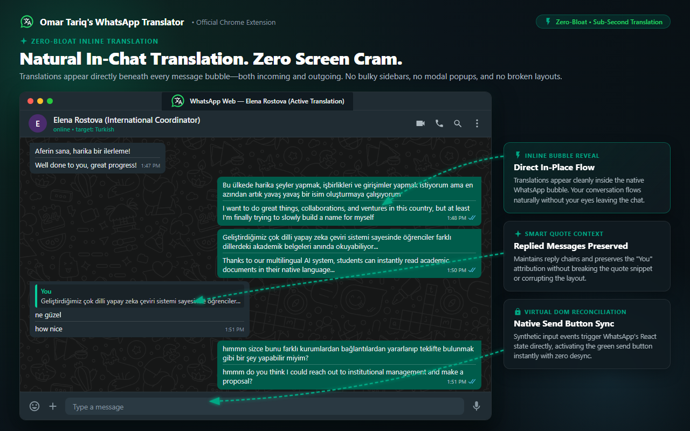

# Omar Tariq's WhatsApp Translator

> **A minimalist, zero-bloat, native-feeling translator extension for WhatsApp Web.**  
> Powered by Chromium Manifest V3 with per-chat memory, colloquial dialect AI, input reconciliation, and inline native ergonomics.

<p align="center">
  
</p>

---

## ⚡ Highlights

- **Zero Cram, Native WhatsApp UI**: No clunky sidebars, floating widgets, or invasive banners. Seamless inline translation tags rendered directly inside native WhatsApp message bubbles.
- **Smart Dialect & Slang Awareness**: Understands colloquial Arabic (*العامية*: Egyptian, Levantine, Gulf), Arabizi, and Turkish street slang without literal butchering.
- **Bi-Directional Translation**:
  - **Incoming Messages**: Double-click any bubble or enable Auto-Translate.
  - **Outgoing Drafts**: Native dock icon in your chat bar or **`Ctrl + Enter`** to translate before sending.
- **React Virtual DOM Reconciliation**: Injects text via synthetic input events (`InputEvent('insertText')`) so WhatsApp's native send button activates properly without desynchronizing React internal state.
- **Instant Custom Dictionary & Corrections**: Notice a translation that could be phrased better? Click the inline **✎** icon on any translated bubble to teach the extension your preferred phrasing (<0.01ms Fastpath memory).
- **Per-Chat Language Memory**: Remembers distinct target languages for different contacts in `chrome.storage.local`.
- **Privacy-First & Zero Telemetry**: Zero telemetry, zero analytics, zero external proxy servers. API keys are stored locally on your device.

---

## 🏗️ Architecture & Technical Pillars

```
┌────────────────────────────────────────────────────────┐
│                   WhatsApp Web Tab                     │
│  (Isolated Content Script: MutationObserver + UI Hooks) │
└───────────────────────────┬────────────────────────────┘
                            │ chrome.runtime.sendMessage
                            ▼
┌────────────────────────────────────────────────────────┐
│           Background Service Worker (MV3)             │
│  - Bypasses web.whatsapp.com CSP / CORS restrictions   │
│  - Fastpath 0: Local User Dictionary (<0.01ms match)   │
│  - Smart Classifier: Routes colloquial slang to AI     │
│  - Multi-Provider Waterfall: Groq ➔ OpenRouter ➔ OpenAI ➔ Gemini ➔ MT │
└────────────────────────────────────────────────────────┘
```

1. **CSP & CORS Bypass via Background Service Worker**:  
   WhatsApp Web enforces strict Content Security Policies that block arbitrary external `fetch()` calls. All translation requests are dispatched through the extension's MV3 service worker.
2. **Virtual DOM Synchronization**:  
   Direct `element.innerText` modifications fail on modern WhatsApp Web because React tracks text in its internal Fiber state. The extension dispatches synthetic `beforeinput` and `input` events with `insertText`, maintaining 100% synchronization.
3. **Isolated Content Script World**:  
   Scoped strictly to `https://web.whatsapp.com/*` with `"all_frames": false` to prevent duplicate MutationObservers in sub-iframes and isolate extension memory.

---

## 🚀 Quickstart & Installation

### Option 1: Load Unpacked in Chrome or Brave
1. Clone or download this repository:
   ```bash
   git clone https://github.com/your-username/omar-tariqs-whatsapp-translator.git
   ```
2. Open your browser and navigate to:
   - **Chrome**: `chrome://extensions`
   - **Brave**: `brave://extensions`
3. Enable **Developer mode** (toggle in the top-right corner).
4. Click **Load unpacked** and select the folder containing `manifest.json`.
5. Open [WhatsApp Web](https://web.whatsapp.com) and start chatting!

---

## ⌨️ Shortcuts & Controls

| Action | Trigger |
| :--- | :--- |
| **Translate Incoming Message** | Double-click any message bubble |
| **Translate Input Draft** | Click the translation icon in the format bar or press **`Ctrl + Enter`** |
| **Report / Correct Translation** | Hover over any translated message and click the **✎** icon |
| **Change Chat Language** | Three-dots menu (⋮) in WhatsApp header ➔ **Change target language** |
| **Extension Settings** | Click the extension icon in browser toolbar |

---

## 🛠️ Configuration & Providers

The extension includes a **Provider Priority Stack** in the popup settings:
- **Free Instant MT**: Google Translate API (zero configuration, zero API keys required).
- **Groq LPU**: Ultra-fast LPU inference (<300ms latency).
- **OpenAI**: Direct integration with OpenAI chat models using your own API key and model ID.
- **Google Gemini**: Nuanced colloquial and literary translation using your own API key and model ID.
- **OpenRouter**: Access to a broad ecosystem of community models.

---

## 🧪 Verification & Automated Testing

The project includes an automated test suite verifying edge cases across Arabic colloquialisms, Turkish slang, quote-reply separation, format preservation, and fastpath matching:

```bash
# Run all test suites
node scratch/test-v5.5-custom-corrections-and-generalized-ai.js
```

---

## 📄 Disclaimer

This extension is an independent open-source project created by **Omar Tariq** and is not affiliated with, endorsed by, sponsored by, or associated with WhatsApp or Meta Inc.

## 📜 License

Distributed under the [MIT License](LICENSE).
